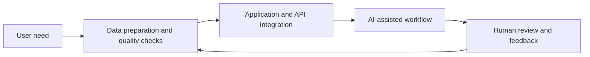

# Applied AI for B2B sales — Professional case study

> **Portfolio summary of work completed during a final engineering internship at SAP.** This high-level account contains no company source code, customer records, internal screenshots, exports, credentials or unpublished architecture diagrams. This is not an SAP-endorsed publication.

## The business problem

Reliable account data and efficient preparation are essential to B2B sales. Fragmented sources, inconsistent CRM records and repeated manual research create friction for teams preparing meetings and prioritizing outreach.

My responsibilities spanned **user needs discovery, technical design, implementation, feedback-driven iterations, testing and handover**.

## Project 1 — AI-powered CRM data quality and enrichment

**Goal:** help sales teams work with more trustworthy account information.

I designed and implemented a **prototype** that brought together structured account data, verification and enrichment workflows, quality confidence assessments, anomaly detection and a user-facing review interface. Suggested corrections could be examined before acceptance.

**Technologies:** Python, FastAPI, PostgreSQL, SQLAlchemy, Streamlit, scikit-learn and Docker.

**My contribution:** translate data-quality pain points into product requirements; design an application architecture; develop backend, data and interface components; test and iterate; document limitations and next steps for handover.

**Status:** engineering prototype, not a claim of a fully production-hardened product.

## Project 2 — AI Sales and Account Planning Agent

**Goal:** reduce the manual effort of preparing business account plans and meeting briefs.

I developed an LLM-assisted workflow combining relevant authorized account context with language-model synthesis. The assistant supported preparation of structured sales briefs and account planning material. Iterations reflected feedback from intended users.

**Technologies:** Node.js, LLM API integration, data processing and web application interfaces.

**My contribution:** identify priority workflows, design the prototype, connect components, test with users and improve delivery.

## Engineering takeaway

**Better source data leads to better business AI.** The most important lessons were to connect AI to an actual user workflow, validate data inputs, design for human review, measure usefulness, and leave maintainable documentation.

## Conceptual workflow (original portfolio illustration)

This is **not** a diagram of SAP systems, infrastructure or proprietary data flows.

## Confidentiality and provenance

The projects were created in a company environment. **The code, internal data, business screenshots, documents, model endpoints, internal performance figures and detailed integration design are not publicly available**. The professional experience described here is distinct from the independently developed open-source projects on this profile. Publication of more detailed evidence would require appropriate employer clearance.

[← Back to my GitHub profile](../../README.md)
